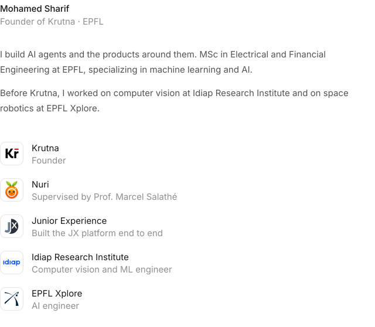

<picture>
  <source media="(prefers-color-scheme: dark)" srcset="./assets/profile-dark.svg">
  
</picture>

<a href="https://www.linkedin.com/in/mar-alsharif"><picture><source media="(prefers-color-scheme: dark)" srcset="./assets/link-linkedin-dark.svg"></picture></a>&nbsp;&nbsp;&nbsp;
<a href="https://mar-alsharif.com"><picture><source media="(prefers-color-scheme: dark)" srcset="./assets/link-website-dark.svg"></picture></a>&nbsp;&nbsp;&nbsp;
<a href="https://krutna.com"><picture><source media="(prefers-color-scheme: dark)" srcset="./assets/link-krutna-dark.svg"></picture></a>
